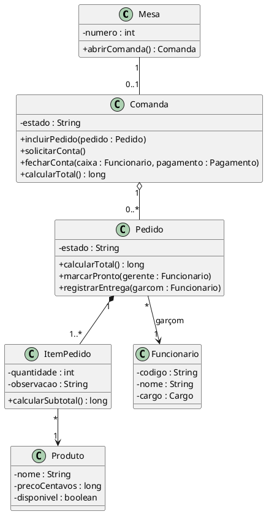
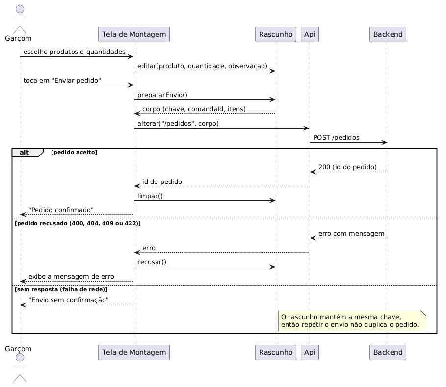

# 01 — Diagrama de Classes do Domínio

**Responsável:** Pither Mikael Gonçalves Duarte (`@pitherduarte`)
**Atividade:** [LAB] AT-11-17 — Básico de UML com PlantUML

Este diagrama apresenta as classes centrais do atendimento no ATLAS: a mesa, a comanda aberta nela, os pedidos lançados pelo garçom, os itens de cada pedido e os produtos do cardápio. Mostra também a relação entre o pedido e o funcionário responsável por ele.

