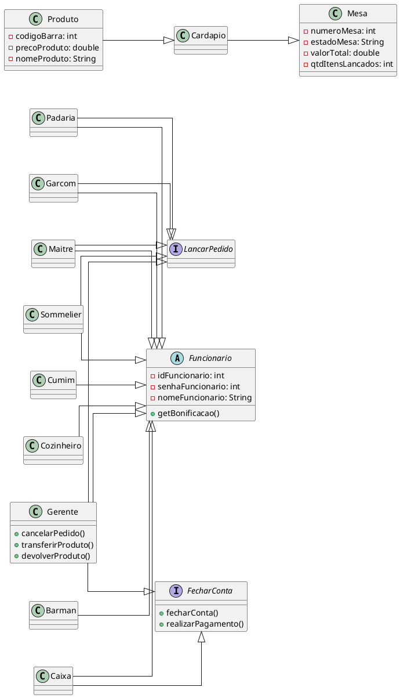

Diagrama de Classes

**Responsável:** Lucas Póvoa

## Descrição

Este diagrama representa a estrutura de classes do sistema de gerenciamento de restaurante, apresentando as classes de funcionários, suas especializações, interfaces e relacionamentos principais.

## Código PlantUML

## Visualização do Diagrama

